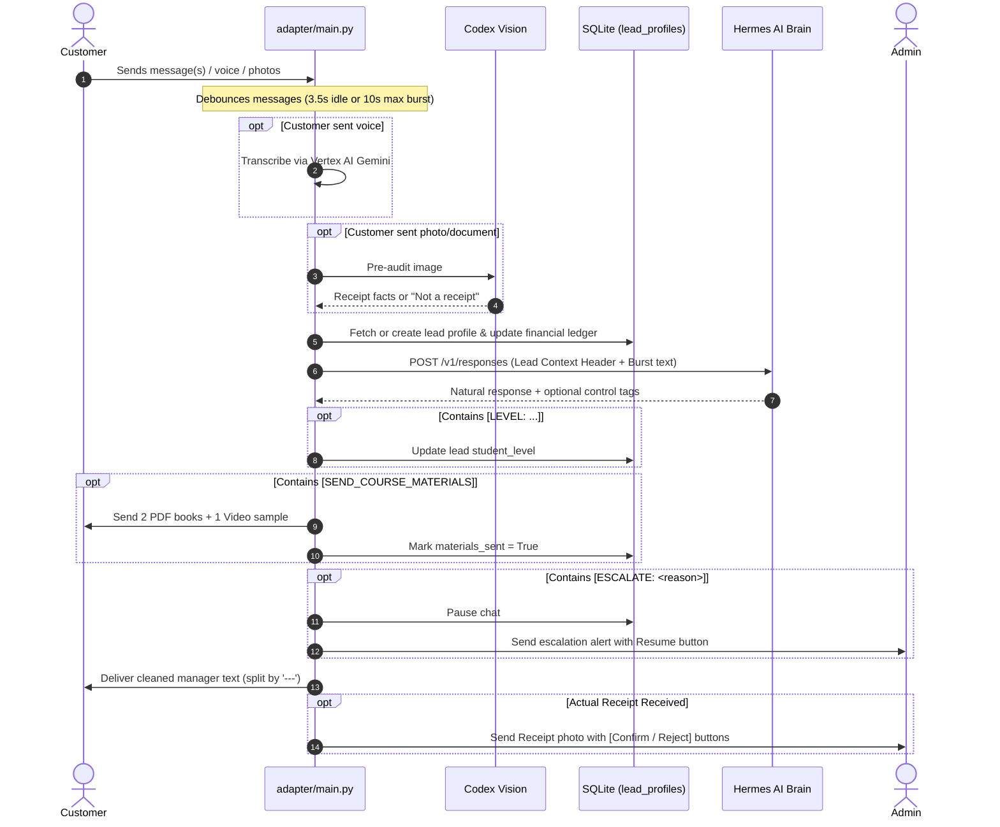

# Kasimova Rus — Telegram Business AI Sales Agent Architecture & Behavioral Specification

This document is the definitive technical onboarding and architecture guide for any coding agent working on the **Kasimova Rus** AI Sales Bot (`po-russki gaplashamiz` 16.0 Russian course).

---

## 1. High-Level System Architecture

The system connects customer inquiries on Telegram Business to an autonomous Hermes AI agent that acts as the official sales manager (Zaynab Kasimova's assistant).

```mermaid
flowchart TD
    Customer["Telegram Customer (DM / Business Chat)"]
    Telegram["Telegram API (aiogram 3)"]
    Adapter["Adapter Service (main.py)\n[Port internal, debouncing, CRM ledger]"]
    Hermes["Hermes AI Agent (gateway:8642)\n[LLM Brain, SOUL.md, SKILL.md]"]
    Vision["Codex Vision Audit\n[Pre-checks receipts against COURSE_DETAILS.md]"]
    SQLite["SQLite DB (adapter.sqlite3)\n[lead_profiles, chat_messages, records]"]
    Config["COURSE_DETAILS.md\n[Single Source of Truth, Hot Reload]"]
    Admin["Admin Telegram Chat / Alerts"]

    Customer <-->|Sends & Receives DMs| Telegram
    Telegram <-->|Business Connections & DMs| Adapter
    Adapter -->|Debounce & Read Config| Config
    Adapter -->|Pre-audit photo/doc| Vision
    Adapter -->|Read & Update Lead Profile| SQLite
    Adapter <-->|HTTP POST /v1/responses with Lead Context| Hermes
    Adapter -->|Deliver Samples if [SEND_COURSE_MATERIALS]| Customer
    Adapter -->|Alert on Receipt / Escalation| Admin
```

### Core Architecture Philosophy
1. **100% LLM-Driven Decisions:** No hardcoded regex gatekeepers or canned responses intercept normal sales conversation.
2. **1st-Person Human Persona:** Hermes speaks strictly as the sales manager (*"men yordam beraman"*, *"chekingizni qabul qilib oldim"*), never referring to a separate 3rd-person manager unless real human intervention is required.
3. **Single Source of Truth (Zero-Downtime Hot Reload):** All business parameters (pricing, discount deadlines, start dates, bank requisites) live in [COURSE_DETAILS.md](file:///opt/hermes-clients/clients/kasimova-rus/COURSE_DETAILS.md). Changes take effect instantly without restarting containers.

---

## 2. Codebase Map & Environments

* **GitHub Repository:** `https://github.com/estoyse/kasimova-rus`
* **Server Root Directory:** `/opt/hermes-clients/clients/kasimova-rus`

| File / Directory | Purpose |
| :--- | :--- |
| [COURSE_DETAILS.md](file:///opt/hermes-clients/clients/kasimova-rus/COURSE_DETAILS.md) | Single Source of Truth for prices, deposit amounts, start dates, and bank cards. Monitored via file `mtime`. |
| [adapter/main.py](file:///opt/hermes-clients/clients/kasimova-rus/adapter/main.py) | Full adapter engine: debouncing buffer, SQLite CRM ledger, Vision pre-check, LLM tag parsing, admin notifications. |
| [adapter/Dockerfile](file:///opt/hermes-clients/clients/kasimova-rus/adapter/Dockerfile) | Python 3.13 lightweight container environment. |
| [data/SOUL.md](file:///opt/hermes-clients/clients/kasimova-rus/data/SOUL.md) | Persona prompt: Tone of voice, 5-stage funnel, confirmed facts, escalation boundaries. |
| [data/skills/productivity/russian-course-sales/SKILL.md](file:///opt/hermes-clients/clients/kasimova-rus/data/skills/productivity/russian-course-sales/SKILL.md) | Skill configuration consumed by Hermes gateway. |
| [docker-compose.yml](file:///opt/hermes-clients/clients/kasimova-rus/docker-compose.yml) | Service definitions for `hermes` (LLM gateway) and `adapter`. |
| [data/adapter/adapter.sqlite3](file:///opt/hermes-clients/clients/kasimova-rus/data/adapter/adapter.sqlite3) | Persistent SQLite database storing CRM profiles and logs. |

---

## 3. End-to-End Inbound Message Flow



### Detailed Steps:
1. **Inbound & Isolation:**
   - In `on_business_message`: Checks `conn.user.id == BUSINESS_OWNER_ID`. If message is from a different business connection, it is ignored.
   - **Manager Intervention Auto-Pause:** If `message.from_user.id == BUSINESS_OWNER_ID`, the human manager is intervening. The bot pauses automatically for this chat (`set_chat_paused(chat_id, True)`).
2. **Burst Debouncing:**
   - User messages are buffered into `chat_buffers[chat_id]`.
   - Timer waits `DEBOUNCE_WAIT = 3.5s` of inactivity or up to `MAX_BURST_WAIT = 10.0s` total burst time.
3. **Voice & Photo Pre-Processing:**
   - Audio is transcribed via Vertex AI Gemini 2.5 Flash (`transcribe_voice_with_gemini`).
   - Photos/documents are analyzed via `analyze_receipt_with_vision`. `is_image_payment_receipt` categorizes the image as either a payment receipt or regular media.
4. **CRM Context Header (`build_lead_context_header`):**
   - Injects running state directly into Hermes prompt:
     - Student level (if known).
     - Materials sent status.
     - Financial state: total paid, remaining balance, and new incoming payment details.
5. **Prompting Hermes & Tag Parsing:**
   - Request sent to `http://hermes:8642/v1/responses`.
   - Assistant reply is parsed for control tags: `[LEVEL: ...]`, `[SEND_COURSE_MATERIALS]`, `[ESCALATE: ...]`.
   - Tags are stripped before sending the message to the customer.
6. **Multi-Message Delivery:**
   - Messages containing `---` delimiter are split and delivered sequentially with human-like delays (0.8s) via `send_customer_message`.

---

## 4. The 5-Stage Sales Funnel Protocol

Defined in [SOUL.md](file:///opt/hermes-clients/clients/kasimova-rus/data/SOUL.md) and executed by Hermes:

```mermaid
stateDiagram-v2
    [*] --> Stage1_Greeting: Customer says "Salom / Assalomu alaykum"
    Stage1_Greeting --> Stage2_CourseOverview: Inquires about course
    Stage2_CourseOverview --> Stage3_LevelDiscovery: Mentions knowledge level
    Stage3_LevelDiscovery --> Stage4_PriceAndPayment: Asks price or payment details
    Stage4_PriceAndPayment --> Stage5_ReceiptAndBalance: Sends payment screenshot
    Stage5_ReceiptAndBalance --> [*]: Balance confirmed / Waiting for class start

    state Stage1_Greeting {
        description: Greet warmly + Ask how to help. DO NOT jump into level testing.
    }
    state Stage2_CourseOverview {
        description: 2-sentence summary of 16.0 + Ask if starting from 0 or needs speaking practice.
    }
    state Stage3_LevelDiscovery {
        description: Confirm matching group + emit [SEND_COURSE_MATERIALS] [LEVEL: <daraja>].
    }
    state Stage4_PriceAndPayment {
        description: Official price 1.49M, promo 980k, booking 100k. Provide Uzcard & VISA upon confirmation.
    }
    state Stage5_ReceiptAndBalance {
        description: Thank customer + exact cumulative balance calculation. No canned rejects.
    }
```

### Script & Language Matching
- If customer writes in **Uzbek Latin**, reply in **Latin**.
- If customer writes in **Uzbek Cyrillic**, reply in **Cyrillic**.
- If customer writes in **Russian**, reply in **Russian**.

---

## 5. Control Tags Protocol (Hermes ↔ Adapter)

Hermes communicates actionable decisions to the adapter using explicit tags embedded in its generation:

| Tag | Trigger Condition | Adapter Action |
| :--- | :--- | :--- |
| `[SEND_COURSE_MATERIALS]` | Customer reveals level (Stage 3) or explicitly asks for lesson samples. | Dispatches 2 PDF books (`InputMediaDocument`) + 1 Video lesson (`send_video`). Marks `materials_sent = 1`. |
| `[LEVEL: <daraja>]` | Hermes identifies student's level (e.g. `0 dan boshlovchi` or `Razgovor`). | Updates `lead_profiles.student_level` in SQLite. Future prompts will not re-ask level. |
| `[ESCALATE: <reason>]` | 1) Actual refund demand.<br>2) Legal/court threat or fraud accusation.<br>3) Strict demand for human operator / phone call. | Pauses the bot for this chat (`set_chat_paused(chat_id, True)`), alerts admin with `▶️ Botni qayta yoqish` inline button, and sends polite manager holding message. |

> [!IMPORTANT]
> The adapter regex-cleans all `[...]` control tags from `reply_text` before delivering it to the customer. The customer never sees the raw tags.

---

## 6. Financial Ledger & Cumulative Multi-Payment Handling

In real-life sales, customers rarely pay only once:
1. They pay **100 000 UZS** to book a seat.
2. Two days later, they pay **400 000 UZS** partial payment.
3. Later, they pay the remaining balance.

### Implementation Details:
* **Storage:** Table `lead_profiles` in `adapter.sqlite3`:
  - `total_paid`: running sum of all confirmed payments.
  - `remaining_balance`: `max(0, full_price - total_paid)`.
  - `payment_history`: JSON array of `[{"amount": 100000, "timestamp": ...}, ...]`.
* **Zero Canned Rejections:**
  If a customer submits an invalid receipt, wrong recipient, or unexpected amount:
  - The adapter **does NOT abort (`return`)** with a hardcoded rejection.
  - Instead, the audit findings are passed into `build_lead_context_header`:
    `"- TO'LOV CHEKI TAHLILI (OGOHLANTIRISH): Qabul qiluvchi: Rasmiy hisobimizga mos EMAS! Qat'iy ko'rsatma: To'lov bizning hisobga tushmaganini xushmuomalalik bilan tushuntiring..."`
  - Hermes reads the facts and replies in natural conversational tone.

---

## 7. Zero-Downtime Dynamic Markdown Hot Reload

Course parameters are maintained in [COURSE_DETAILS.md](file:///opt/hermes-clients/clients/kasimova-rus/COURSE_DETAILS.md):

```markdown
# Kurs Ma'lumotlari va Savdo Sozlamalari

## 1. Narxlar va Muddatlar
- **Kurs nomi:** po-russki gaplashamiz 16.0
- **Asl narxi:** 1 490 000 so'm
- **Predzapis narxi (to'liq kurs):** 980 000 so'm
- **Joy band qilish (minimal to'lov):** 100 000 so'm
- **Darslar boshlanish sanasi:** 10-noyabr
- **Dars davomiyligi:** 2 oy

## 2. Rasmiy To'lov Rekvizitlari
- **Uzcard (O'zbekiston):**
  - Karta raqami: `5614 6821 1260 5573`
  - Karta egasi: Zaynab Qosimova
  - Bank: Ipak yo'li bank

- **VISA (Chet el to'lovlari):**
  - Karta raqami: `4916 9903 1015 2035`
  - Karta egasi: Qosimova Zaynab
  - Bank: Uzum Bank
  - Ulangan telefon raqami: `+998 97 021 16 60`
  - Chet el narxlari: 6 760 rubl / 39 000 tenge / 7 200 som / 82 $
```

### Hot-Reload Logic in `adapter/main.py`:
- `get_course_details()` compares `os.path.getmtime(COURSE_DETAILS_PATH)` on every incoming message.
- If changed, it re-parses the values into cache in `< 1ms`.
- Updates affect Hermes prompts, Vision audit, and CRM balance calculation instantly **without restarting Docker containers**.

---

## 8. Testing & Safe Isolation Rules

> [!CAUTION]
> **Strict Isolation Rule:**
> When running tests or debugging, **NEVER message or interfere with the real client Kasimova's Telegram account (`8495514779`)** or the real admin group (`-1004373296128`).
>
> All active testing is configured to use the developer's test account:
> - **Test Business Owner / Admin ID:** `7340743515` (User: Izzatillo Azimov, `@estoyse`)
> - **Bot Username:** `@kasimova_rus_agent_bot`

### Useful Diagnostic Commands
```bash
# Check running containers
docker ps --filter "name=kasimova"

# View live adapter logs
docker logs -f --tail 50 hermes-kasimova-rus-adapter

# View live Hermes AI brain logs
docker logs -f --tail 50 hermes-kasimova-rus

# Rebuild adapter container after modifying adapter/main.py
cd /opt/hermes-clients/clients/kasimova-rus
docker compose build adapter && docker compose up -d adapter

# Push updates to GitHub
cd /opt/hermes-clients/clients/kasimova-rus
git add .
git commit -m "fix/feat: description"
git push
```
